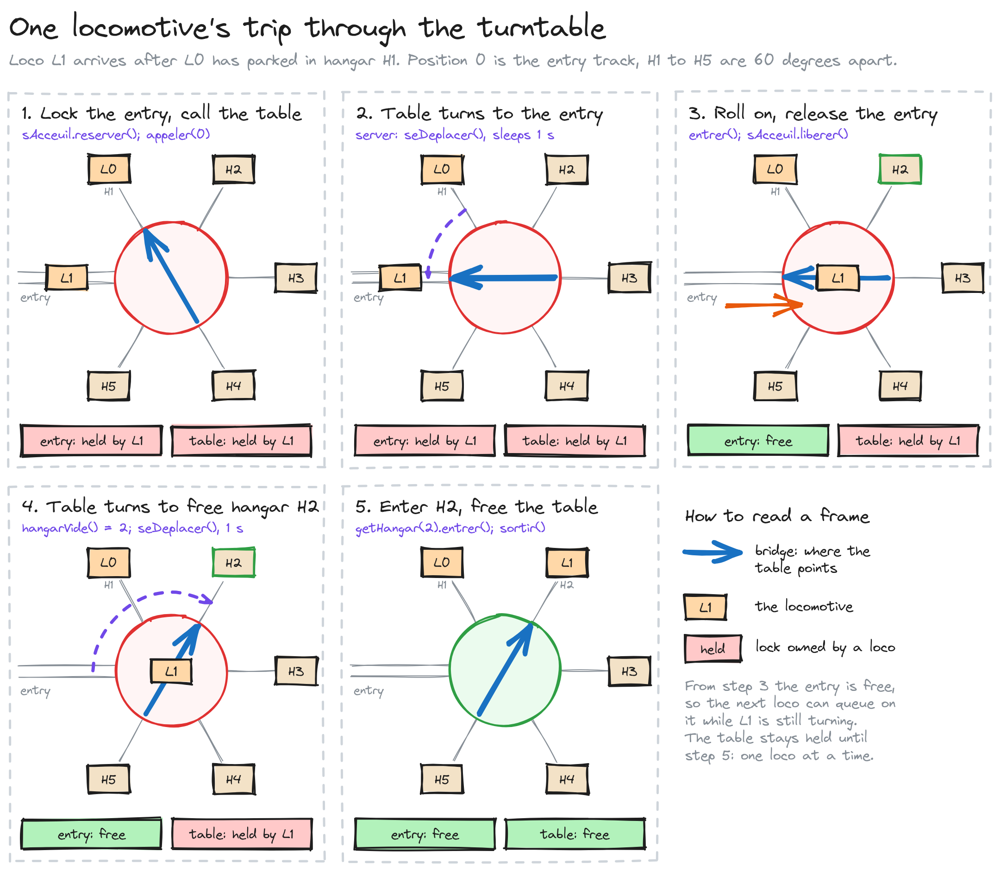
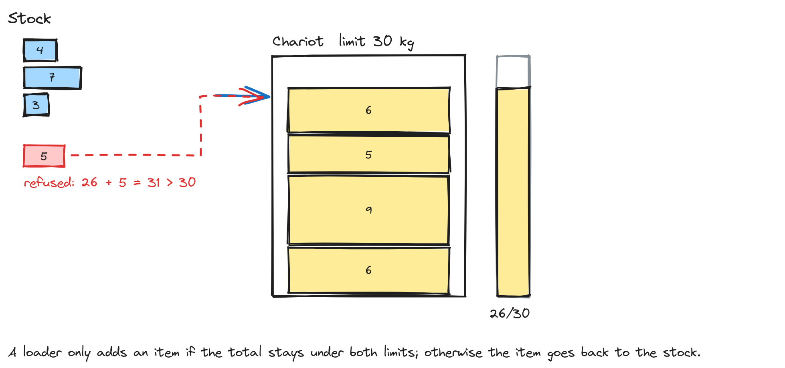
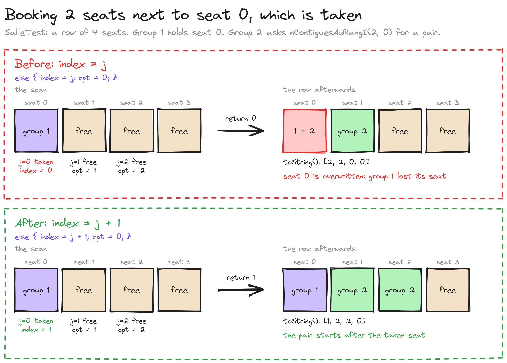
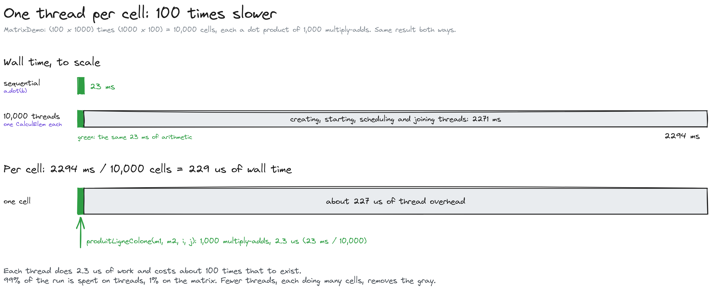

# Concurrent programming in Java

Four small systems that show how threads cooperate through locks, conditions and joins. Each one models a real situation (trains sharing a turntable, a conveyor loading a truck, a room being booked by several groups, a matrix split across workers), and each has a runnable demo and automated tests.

[](https://github.com/mbeni12333/ConccurentProgramming/actions/workflows/build.yml)


## Context

This started as coursework for a Java concurrency course (LU3IN001). The original code was a set of standalone `main()` programs with no build file and no tests. It has been rebuilt as a Maven project: sources and tests are separated, the build runs in CI, and each exercise has checks that describe what it should do.

The core question in every exercise is the same: several threads share state, so who may touch it, when, and how do they wait for each other? The four systems answer that with three tools from `java.util.concurrent.locks` and the language itself:

- **`synchronized`** for short, exclusive access to a shared object;
- **`ReentrantLock` with `Condition`s** when a thread has to wait until something becomes true (a seat is free, the chariot is full);
- **`Thread.join()`** to wait for workers to finish before reading their results.

## The four systems

### 1. Locomotive hangar: a turntable shared by trains

Trains enter a hangar pool through a single turntable. Only one locomotive can use the turntable at a time, so a locomotive must lock the entry track, call the turntable to face it, roll onto the table, and then wait for the table to face a free hangar before entering it. The turntable is a server thread that runs the movements in order.



Classes: `Locomotive.Loco`, `SegTournant` (the turntable), `SegAcceuil` (the entry track), `HangarPool`, `Hangar`.

### 2. Conveyor: loaders, a chariot, unloaders

A stock of random-weight items feeds five loader threads. They load a chariot with a weight limit (30 kg) and an item limit (10). Five unloader threads empty it again. A loader that would exceed a limit gives the item back to the stock. Loaders wait while the chariot is not empty; unloaders wait while it is not full.



Classes: `Convoyeur.Chargeur` (loader), `Dechargeur` (unloader), `Chariot` (the shared buffer), `AleaStock` and `AleaObj` (the items).

### 3. Room reservation: groups booking seats

A room is a grid of seats. A group asks for `n` seats and gets them in one row if possible, or scattered across the room otherwise. Several groups book and cancel at the same time, so the seat state is shared and every change is made under `synchronized`.



Classes: `Reservation.Salle` (the room and its allocation logic), `Groupe` (a group that books and cancels).

### 4. Matrix product: work split across threads

`Matrix2d.dot` computes a matrix product sequentially. `MatrixDemo` computes the same product with one thread per output cell, joins all the threads, and checks the result against the sequential one. It also reports both timings, so you can see what splitting work costs.



On the demo's 100×1000 by 1000×100 product, the sequential version takes about 23 ms and the one-thread-per-cell version about 2.3 s. Each cell is a 1000-term sum (about 2 µs of arithmetic), so the cost of creating and joining 10,000 threads dominates. Splitting the rows across a few threads is the usual fix; the demo keeps the naive version so the cost is visible.

Classes: `Matrix.Matrix2d`, `CalculElem` (one cell per thread), `MatrixDemo`.

## Running it

Requires JDK 25 or newer. Maven isn't needed: the wrapper downloads the pinned version.

```bash
./mvnw verify                                         # compile and run all tests
java -cp target/classes Locomotive.LocomotiveDemo     # trains through the turntable
java -cp target/classes Convoyeur.ConvoyeurDemo       # loaders and unloaders on the chariot
java -cp target/classes Reservation.ReservationDemo   # groups booking seats
java -cp target/classes Matrix.MatrixDemo             # sequential vs one thread per cell
java -cp target/classes ThreadedWindow.WindowThread   # threads drawing lines, needs a display
```

The demos print their progress to the console. Each one exits when its work is done.

## Tests

```bash
./mvnw test
```

22 JUnit 5 tests, grouped by system:

- **Matrix:** arithmetic and shape checks, the product checked against a reference result (`test-data/res`), and the threaded version checked against the sequential one.
- **Reservation:** contiguous and scattered allocation, refusal when the room is full, release, and a stress run of 8 threads booking and cancelling at the same time.
- **Conveyor:** the chariot's weight and item limits, unloading in order, independent chariots, and the stock's weight range and ordering.
- **Locomotive:** the hangar pool, and a full run of five locomotives through the turntable with a timeout, so a stuck run fails instead of hanging.

The concurrency tests check final states and invariants rather than timing, so they should not depend on machine speed.

## Project layout

```text
src/main/java/   sources, one folder per system (package = folder name)
src/test/java/   JUnit tests, same package layout
test-data/       matrix inputs and a reference product
docs/assets/     diagrams used in this README
doc/             course statements (PDF)
pom.xml          Maven build: JDK 25, JUnit 6
.github/         CI: ./mvnw verify on every push
```

Demos are named `*Demo` rather than `*Test`, so Maven runs them only when asked, not as tests.

## Known limitations

- `Chargeur` uses a `static` flag to decide which loader closes the chariot, so only one chariot per process behaves correctly.
- `Dechargeur` and the turntable's protocol poll with `awaitNanos` and a spin loop. They work, but they keep a CPU busy while waiting; a blocking hand-off would be cleaner.
- `SegTournant` loops forever. The demos run it as a daemon thread so the program can exit, but there is no clean shutdown signal.

## Origin

Coursework from LU3IN001, rebuilt as a Maven project. The original history is in git, and the course statements are in `doc/`.
